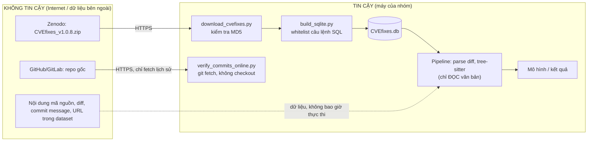

# THREAT MODEL – DT073

> Phạm vi: pipeline trích cặp mã trước/sau từ CVEfixes và phân loại CWE.
> Đề yêu cầu xác định **leakage, class imbalance, privacy, trust boundary** trước khi huấn luyện.
> Số liệu căn cứ: `results/eda/EDA_A.md`, `results/eda/EDA_B.md`, `data/reports/data_quality.md`.
> Hai loại "mối đe dọa": (1) đe dọa **tính hợp lệ của kết quả** (leakage, imbalance, label noise);
> (2) đe dọa **an toàn hệ thống & dữ liệu** (trust boundary, privacy).

## 1. Trust boundary

| # | Điểm qua ranh giới | Rủi ro | Biện pháp đã cài đặt | Kiểm chứng |
|---|---|---|---|---|
| T1 | Tải zip từ Zenodo | File bị sửa/hỏng khi tải | So MD5 với giá trị Zenodo công bố; ghi SHA-256 vào `MANIFEST.json` | MD5 khớp `4586a358…` |
| T2 | **Thực thi SQL dump** vào SQLite | Dump độc hại: `ATTACH DATABASE` ghi file tùy ý, `VACUUM INTO`, `PRAGMA writable_schema`, `DROP`, `load_extension` | **Whitelist** chỉ cho `PRAGMA foreign_keys`, `BEGIN/COMMIT`, `CREATE TABLE/INDEX`, `INSERT` vào bảng do chính dump tạo; Python sqlite3 mặc định tắt load_extension | `test_unsafe_statements_rejected` (8 câu độc hại bị chặn); dry‑run toàn bộ dump thật: 0 câu bị chặn |
| T3 | Nội dung mã/diff | Mã khai thác, chuỗi rất lớn, ký tự lạ làm treo/crash parser | Không biên dịch/chạy mã; parser diff tự viết không ném ngoại lệ; giới hạn `max_hunk_lines`, `max_lines_changed_per_file`; tree-sitter chịu lỗi | `test_garbage_does_not_raise`, `test_broken_fragment_does_not_raise` |
| T4 | URL repo & hash trong dataset → lệnh `git` | Command/argument injection, giao thức `file://`, `ext::` | Chỉ nhận `https://github.com|gitlab.com|bitbucket.org/<owner>/<repo>`, hash 40 hex; truyền tham số dạng list (không qua shell); `GIT_TERMINAL_PROMPT=0`; timeout; repo bare tạm, `--filter=blob:none`, không checkout | `test_online_rejects_unsafe_input` |
| T5 | Đường dẫn file trong dataset | Path traversal khi ghi file | Pipeline **không ghi file theo tên lấy từ dataset**; chỉ ghi vào đường dẫn cố định trong `data/`, `results/` | Rà soát code |
| T6 | Artifact mô hình (pickle/joblib) | Nạp pickle không tin cậy = thực thi mã | Chỉ nạp artifact do chính pipeline tạo; không nạp mô hình tải từ ngoài | Quy ước, ghi trong README |
| T7 | Bí mật | Lộ token khi đẩy repo | Không dùng token; `.gitignore` chặn `.env`, `*.token`, `data/raw`, `data/db` | Kiểm tra trước khi nộp (Bước 8) |

## 2. Privacy

| Dữ liệu | Hiện trạng (EDA-A3) | Quyết định |
|---|---|---|
| `commits.author`, `commits.committer` | Có ở 12 104/12 107 commit | **Không đưa** vào dữ liệu dẫn xuất (metadata.py không đọc các cột này) |
| `commits.msg` | 2 525 message chứa email | Không đưa vào dữ liệu dẫn xuất |
| Email trong mã nguồn (comment bản quyền…) | Đếm trong `summary.json → privacy` | Thay bằng `<EMAIL>` (`privacy.mask_emails: true`) |
| Toàn bộ dữ liệu | Công khai, CC BY 4.0 | Chỉ dùng cho nghiên cứu; trích dẫn nguồn; không làm giàu thêm thông tin cá nhân |

## 3. Leakage (đe dọa tính hợp lệ)

| Nguồn rò rỉ | Bằng chứng trong CVEfixes | Biện pháp |
|---|---|---|
| Cùng repo ở train và test | Random split: train/test chung **1 303 repo** | Split chính = **project**: nhóm theo repo |
| Fork / cùng CVE sửa ở nhiều repo | VD CVE-2008-1897 có 8 commit ở 8 fork Asterisk; random split chung **2 687 CVE** | Nhóm rò rỉ gộp repo + **CVE** |
| Mã trùng / gần trùng (cherry-pick, copy) | Duplicate rate exact 2,3% · normalized 7,6% · near 8,8% | Dedup 3 mức **trước** khi chia; nhóm rò rỉ gộp cả cụm near-dup |
| Rò rỉ theo thời gian | Commit trải 1999–2024 | Time split (train < cutoff ≤ test) làm phép thử bổ sung |
| Chọn mô hình trên test | – | Chỉ chọn siêu tham số trên **val**; test chỉ chạm 1 lần cho mỗi cấu hình đã đăng ký |
| Tiền xử lý học từ toàn bộ dữ liệu | TF-IDF vocab, scaler… | Mọi bước `fit` chỉ trên train (sklearn Pipeline) |

Kiểm chứng tự động: `leakage_report()` phải cho 0 repo / 0 CVE / 0 cụm chung giữa train và test của project split (test `test_project_split_has_no_leakage` và tiêu chí D2 trong PREREGISTRATION).

## 4. Class imbalance (đe dọa tính hợp lệ)

- Long-tail: 207 CWE; CWE-79 chiếm ~14% hunk có nhãn; top-10 chỉ phủ ~46%.
- Biện pháp: giữ top-K theo quy tắc ≥ 500 hunk/lớp; `class_weight="balanced"`; **Macro-F1 là metric chính**, kèm MCC, per-class P/R; không dùng Accuracy làm metric chính.
- Rủi ro còn lại: CWE có quan hệ cha–con (CWE-119 ⊃ CWE-787/CWE-125) → nhầm lẫn có hệ thống; sẽ phân tích trong confusion matrix và phân tích lỗi.

## 5. Label noise (đe dọa tính hợp lệ)

- Nhãn CWE gán ở **mức CVE**, áp cho mọi hunk trong commit → hunk không liên quan (refactor, test) mang nhãn sai.
- Bằng chứng: 12,3% CVE chỉ có nhãn không cụ thể; 148 cụm near-dup có nhãn mâu thuẫn (913 hunk).
- Biện pháp: loại nhãn không cụ thể và multi-CWE; loại tangled commit; **audit thủ công 200 hunk** (2 người, Cohen's κ) để ước lượng tỷ lệ nhãn đúng.

## 6. Rủi ro còn lại (đưa vào phần Giới hạn)

- Bộ lọc tangled theo p95 loại ~38% file ứng viên → dữ liệu thiên về commit nhỏ.
- Danh sách API nhạy cảm giữ nguyên khi chuẩn hóa là xấp xỉ.
- Kiểm tra online chỉ trên mẫu (không phải toàn bộ commit).
