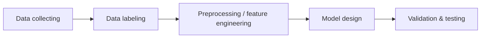

# PHIẾU TÁI LẬP BÀI BÁO (Bước 1 – Đề tài DT073)

> Bài báo: **Survey of source code vulnerability analysis based on deep learning**
> Tác giả: Chen Liang, Qiang Wei, Jiang Du, Yisen Wang (tác giả liên hệ), Zirui Jiang – Information Engineering University, Zhengzhou, China
> Tạp chí: *Computers & Security*, Vol. 148 (2025), Article 104098 — DOI: `10.1016/j.cose.2024.104098`
> Nhận bài 08/04/2024 · Sửa 07/08/2024 · Chấp nhận 02/09/2024 · Online 03/09/2024
> Giấy phép: Open access **CC BY‑NC‑ND 4.0** · File: `1-s2.0-S0167404824004036-main.pdf` (18 trang)
> Người lập phiếu: ……………… · Ngày lập: ………………

---

## 1. Loại bài báo & ý nghĩa với đề tài

| Mục | Nội dung |
|---|---|
| Loại bài | **Survey (bài khảo sát)** – không đề xuất mô hình mới, không có thực nghiệm riêng. |
| Dữ liệu/code của paper | Mục *Data availability* (tr.16): **“No data was used for the research described in the article.”** → không có dataset/code/số liệu gốc để chạy lại. |
| Hệ quả cho tái lập | “Tái lập” = (1) trích phương pháp, dữ liệu, metric, hạn chế mà survey tổng hợp; (2) kiểm chứng thực nghiệm **các nhận định/hạn chế** của survey trên CVEfixes; (3) không so sánh “con số với con số” với paper vì paper không có con số của riêng mình. |
| Lưu ý quan trọng | Survey **không nhắc đến CVEfixes** (0 lần) và **không thảo luận data leakage** (0 lần). Đây là khoảng trống mà đề tài có thể bổ sung (đóng góp riêng). |

---

## 2. Bài toán (Problem)

- Phát hiện lỗ hổng **tĩnh** trên **mã nguồn** bằng ML/DL (tr.2).
- Paper mô tả bài toán chủ yếu là **phân loại nhị phân** “vulnerable / non‑vulnerable” (tr.2, mục 1; tr.4 Fig.4; tr.6 Fig.5).
- Phân loại **đa lớp theo loại lỗ hổng (CWE)** chỉ xuất hiện ở số ít công trình, ví dụ **μVulDeePecker** (116 loại CWE, dữ liệu SARD + NVD, tr.5) và **VulChecker** (xác định loại lỗ hổng, tr.8).
- → Đề tài DT073 (phân loại CWE trên cặp mã trước/sau sửa) thuộc nhánh **ít được khảo sát** này.

## 3. Giả định (Assumptions) – rút ra từ paper

| # | Giả định | Vị trí |
|---|---|---|
| A1 | Mã lỗ hổng có **mẫu đặc trưng** (vulnerable code patterns) mà mô hình học được từ dữ liệu có nhãn. | 2.2.2, tr.3 |
| A2 | Cần **bộ dữ liệu có nhãn chất lượng cao, quy mô lớn** – “the cornerstone is a high‑quality vulnerability dataset”. | 2.2.2, tr.3 |
| A3 | Dữ liệu thực có thể lấy từ **bản ghi lỗ hổng đã sửa** (records of fixed vulnerabilities) – đúng hướng CVEfixes. | 2.2.2, tr.3 |
| A4 | Mã bị **sửa trong patch** được coi là mã có lỗ hổng (TROVON). | 3.1, tr.5 |
| A5 | Biểu diễn mã càng giữ cấu trúc (AST/PDG/CPG) càng tốt hơn token thuần, nhưng tốn chi phí hơn. | 3.3, 4.5, 6.1.4 |

## 4. Pipeline tổng quát theo paper

*(Fig.3, tr.4 – methods based on vulnerable code patterns)*

**Pipeline token sequence (Fig.4, tr.5):** cắt lát mã theo điểm quan tâm (POI slicing) → gán nhãn → **chuẩn hóa** (bỏ ký tự non‑ASCII, bỏ comment, đổi tên biến/hàm thành tên ký hiệu) → vector hóa (thường Word2Vec) → huấn luyện DL → phân loại.

**Pipeline graph (Fig.5, tr.7):** sinh đồ thị cấp hàm (AST/CFG/PDG/CPG, công cụ chủ yếu **Joern**) → graph slicing (loại nhiễu) → gán nhãn → vector hóa node → GNN → phân loại.

**Pipeline AST (Fig.6, tr.10):** sinh AST → duyệt (DFS/preorder) thành chuỗi → chuẩn hóa → vector hóa → RNN (LSTM/GRU).

### Phân loại phương pháp (taxonomy)

| Nhóm | Mô hình | Công trình tiêu biểu (theo paper) |
|---|---|---|
| Software metrics / BoW / N‑gram | ML cổ điển | Scandariato 2014 (BoW), Pang 2015 (N‑gram) – 2.2.1 |
| Token + RNN | BLSTM/BGRU/LSTM | VulDeePecker, LAVDNN, μVulDeePecker, SySeVR, TROVON, VulDeeLocator, VUDENC (Bảng 2) |
| Token + CNN | CNN | Russell et al. 2018, SEVulDet (Bảng 2) |
| CPG | LSTM/GGNN/Transformer | CPGVA, VulSniper, VELVET, VulGDA (Bảng 4) |
| PDG | GCN/GGNN/GAT/CNN | IVDetect, VulCNN, mVulPreter, VulChecker, LineVD (Bảng 4) |
| Đồ thị khác/kết hợp | GCN, Gated GRN, Transformer, BGNN | Phan 2017, Devign, Hellendoorn 2020, BGNN4VD, DeepWukong, VulSPG (Bảng 4) |
| AST | BLSTM/LSTM/BGRU/GGNN | POSTER, Lin 2018, FUNDED, Feng 2020, DeepBalance, Dam 2021, Lin 2021, DeepLineDP (Bảng 4) |
| Khác (similarity, patch, Transformer) | — | VulPecker, VulDetector, VDSimilar, MVP, **LineVul (CodeBERT)**, LINE‑DP, AURC (Bảng 5) |

## 5. Dữ liệu được paper nhắc tới

| Dataset | Loại | Công trình dùng |
|---|---|---|
| SARD / Juliet | Tổng hợp (synthetic) | μVulDeePecker, SySeVR, VulDeeLocator, SEVulDet, CPGVA, VulSniper, VELVET, DeepWukong, VulSPG, VulChecker |
| NVD | Thực | μVulDeePecker, SySeVR, TROVON, VulDeeLocator, SEVulDet, VulSPG, Lin & Cai 2021 |
| Big‑Vul | Thực (C/C++) | IVDetect, mVulPreter, LineVD |
| Devign | Thực (4 thư viện C) | Devign, IVDetect, VulGDA |
| ReVeal | Thực | IVDetect, VulGDA |
| D2A | Thực | VELVET |
| POSTER dataset | Thực, gán nhãn tay (>6000 hàm) | POSTER, Lin 2018, DeepBalance |
| Khác | 1009 security commits (VUDENC), 2149 hàm lỗi (BGNN4VD), 13 687 lỗi / 26 970 sạch (VulCNN), 188k hàm C/C++ (LineVul), Java dataset Wattanakriengkrai (DeepLineDP) | — |

**Các công trình dùng cặp “lỗi – đã vá” (liên quan trực tiếp tới DT073):** TROVON (cặp phiên bản lịch sử), VUDENC (security commits), FUNDED (security‑related commits), VulPecker & VulDetector (diff file), VDSimilar (cặp hàm lỗi vs hàm đã vá), MVP (chữ ký patch).

**Liên quan tới khử trùng lặp:** Russell et al. 2018 – “Redundancy reduction … retaining **10.8%** of functions” (tr.5) → bằng chứng trong paper rằng dữ liệu mã có **tỷ lệ trùng lặp/dư thừa rất cao**.

## 6. Metric

| Metric | Nhắc tới ở |
|---|---|
| Accuracy | Hầu hết công trình (24 lần trong bài) |
| Precision, Recall, F1 | VUDENC, SEVulDet, VulSniper, Devign, VDSimilar, LineVul… |
| FPR / FNR | VulDeePecker, LAVDNN, Feng 2020, VulChecker, Lin & Cai 2021 |
| Top‑10 accuracy | LineVul (line‑level) |

> Paper **không có bảng metric thống nhất** và **không chuẩn hóa điều kiện đánh giá** giữa các công trình → các con số không so sánh trực tiếp được.

## 7. Kết quả mục tiêu (con số do paper trích dẫn từ công trình khác)

| Công trình | Kết quả được trích | Trang |
|---|---|---|
| SEVulDet | F1 = **94.5%** (SARD + NVD) | tr.6 |
| Devign | Accuracy **+10.51%**, F1 **+8.68%** so với baseline | tr.8 |
| VELVET | Vượt công cụ phân tích tĩnh **4.5 lần** | tr.7 |
| SySeVR + BGRU | Phát hiện 15 lỗ hổng mới chưa có trong NVD | tr.5 |
| VulCNN | 73 lỗ hổng mới trên >25 triệu dòng mã | tr.8 |
| Russell et al. | Giữ lại 10.8% hàm sau khử dư thừa | tr.5 |

> **Kết luận cho đề tài:** không có “kết quả mục tiêu” trùng bài toán phân loại CWE trên CVEfixes. Bảng ánh xạ cuối báo cáo sẽ so sánh theo **nhận định định tính** (ủng hộ / không ủng hộ), không tuyên bố vượt paper.

## 8. Hạn chế & điểm cần tái lập (≥ 5)

### 8.1 Hạn chế do chính paper nêu (mục 6.1, tr.14–15)

| # | Hạn chế | Trích ý |
|---|---|---|
| L1 | **Phụ thuộc dữ liệu có nhãn chất lượng cao** | CVE/NVD “suffering from inconsistent annotation quality, labeling errors, and incomplete coverage” (6.1.1) |
| L2 | **Nhiễu & mất cân bằng dữ liệu** | “noise in datasets and data imbalance … the fundamental challenge … remains unresolved” (6.1.1) |
| L3 | **Khả năng giải thích kém** | 6.1.2 |
| L4 | **Tổng quát hóa kém** giữa ngôn ngữ và loại lỗ hổng | 6.1.3 |
| L5 | **Đánh đổi hiệu năng – chi phí tiền xử lý** | 6.1.4 |

### 8.2 Hạn chế/điểm cần tái lập do nhóm nhận xét thêm

| # | Nhận xét | Căn cứ |
|---|---|---|
| L6 | Không thảo luận **rò rỉ train‑test** (trùng project/CVE giữa train và test) | Từ khóa “leak” xuất hiện 0 lần |
| L7 | Gần như chỉ xét **phân loại nhị phân**; phân loại đa lớp CWE ít được khảo sát | Mục 1, Fig.4–5 |
| L8 | Không có **benchmark & metric thống nhất**, nhiều công trình chủ yếu báo cáo Accuracy | Mục 6 phiếu này |
| L9 | Phụ thuộc nhiều vào dữ liệu **tổng hợp SARD/Juliet** | Mục 5 phiếu này |
| L10 | Bản thân survey **không có dữ liệu/code**, không có quy trình tái lập | Data availability, tr.16 |

## 9. Ánh xạ hạn chế → thí nghiệm của đề tài (đóng góp riêng)

| Hạn chế | Câu hỏi nghiên cứu | Thí nghiệm / phép đo trong DT073 |
|---|---|---|
| L1 | RQ3 – chất lượng nhãn | Tỷ lệ `NVD-CWE-Other/noinfo`; xung đột nhãn giữa hunk trùng; audit thủ công 100–200 mẫu + Cohen’s κ |
| L1 | RQ1 – coverage | Phễu CVE → commit → file → hunk, kèm lý do loại |
| L2 + Russell 10.8% | RQ2 – duplicate rate | Exact / normalized / near‑dup (MinHash); cross‑split duplicate |
| L2 | — | Phân bố CWE long‑tail; class_weight; báo cáo Macro‑F1 thay vì chỉ Accuracy |
| L6 | RQ4 – leakage | Random split vs project split vs time split (E1–E3, E7) |
| L4 | RQ4 | Time split (CWE/project mới theo thời gian); per‑language breakdown |
| L5 | RQ5 + chi phí | Đo thời gian/RAM: TF‑IDF thô vs chuẩn hóa tree‑sitter vs CodeBERT |
| L7 | RQ5 | Phân loại đa lớp top‑K CWE trên cặp hunk before/after |
| L8 | — | Macro‑F1, Weighted‑F1, MCC, per‑class P/R, bootstrap CI 95%, McNemar |
| L3 | — | Phân tích hệ số LR / token quan trọng cho từng CWE + phân tích lỗi |
| L10 | — | Repo có README, lock môi trường, manifest + checksum, seed cố định |

## 10. Căn cứ chọn Baseline & Biến thể từ paper

| Thành phần | Lựa chọn | Căn cứ trong paper |
|---|---|---|
| **Baseline** | TF‑IDF / Bag‑of‑Words token + Logistic Regression | 2.2.1: BoW (Scandariato 2014), N‑gram (Pang 2015) là hướng frequency‑based cơ bản |
| **Biến thể 1** | Chuẩn hóa token theo Fig.4: bỏ comment, non‑ASCII, đổi định danh → ký hiệu (dùng **tree‑sitter**) | Fig.4 (tr.5), Feng 2020 (tr.9) |
| **Biến thể 2** | Dùng cả **before + after (diff)** thay vì chỉ before | Ý tưởng patch‑based: TROVON, VDSimilar, MVP, VulPecker |
| **Biến thể 3 (tùy chọn, cần GPU)** | Fine‑tune CodeBERT | LineVul, LineVD; hướng 6.2.3 (pre‑trained models) |
| Không làm | GNN trên CPG/PDG (Joern) | Chi phí cao (6.1.4, Bảng 3) – nêu là hướng phát triển |

## 11. Câu hỏi nghiên cứu & giả thuyết (bản chốt)

| RQ | Câu hỏi | Giả thuyết | Liên hệ paper |
|---|---|---|---|
| RQ1 | Bao nhiêu % bản ghi CVEfixes trở thành cặp hunk before/after hợp lệ? | Coverage giảm mạnh sau validate | L1 (incomplete coverage) |
| RQ2 | Tỷ lệ trùng lặp exact / normalized / near‑dup là bao nhiêu? | Normalized > exact; có trùng chéo train‑test nếu không xử lý | Russell 10.8% |
| RQ3 | Chất lượng nhãn CWE thế nào? | Một phần đáng kể nhãn không cụ thể hoặc không khớp với hunk | L1 |
| RQ4 | Leakage ảnh hưởng thế nào đến Macro‑F1? | Random split > project split > time split | L6, L4 |
| RQ5 | Biến thể có tốt hơn baseline có ý nghĩa thống kê? | Có (CI 95% / McNemar p < 0.05), đổi lại chi phí cao hơn | L5, 6.2.2, 6.2.3 |

**Đối tượng đánh giá:** (a) bộ dữ liệu dẫn xuất từ CVEfixes; (b) mô hình phân loại top‑K CWE trên hunk.
