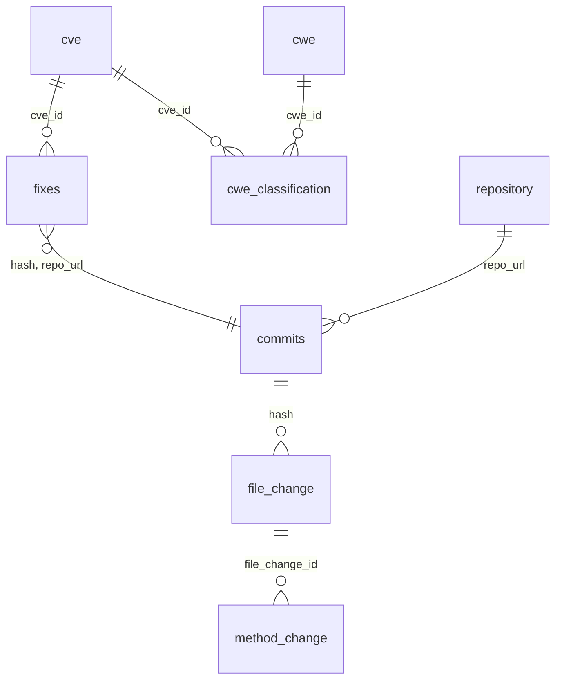
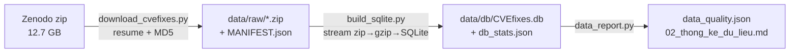

# BƯỚC 2 – CHUẨN BỊ DỮ LIỆU CVEfixes (bản nháp chương 3 báo cáo)

> Số liệu thống kê chi tiết được sinh tự động vào `docs/02_thong_ke_du_lieu.md` sau khi chạy `scripts/run_step2.ps1`.

## 2.1 Nguồn, phiên bản, giấy phép

| Mục | Giá trị |
|---|---|
| Tên | CVEfixes – *Automated Collection of Vulnerabilities and Their Fixes from Open‑Source Software* |
| Tác giả / trích dẫn | G. Bhandari, A. Naseer, L. Moonen. PROMISE ’21, ACM. doi:10.1145/3475960.3475985 |
| Phiên bản | **v1.0.8** – CVE công bố đến **23/07/2024**, phát hành Zenodo ngày 28/07/2024 |
| Nơi tải | Zenodo record 13118970 (concept DOI `10.5281/zenodo.4476563`) |
| Code thu thập | https://github.com/secureIT-project/CVEfixes (MIT) |
| Giấy phép dữ liệu | **CC BY 4.0** – được dùng, chia sẻ dữ liệu dẫn xuất, bắt buộc ghi nguồn |
| File | `CVEfixes_v1.0.8.zip` – 12 708 711 268 byte – MD5 `4586a358977acfa4c60b1a2cdd096221` (Zenodo công bố) |
| SHA‑256 / ngày tải | Ghi tự động trong `data/MANIFEST.json` |
| Quy mô công bố | 12 107 commit sửa lỗi · 4 249 dự án · 11 873 CVE · 272 loại CWE · 51 342 file · 138 974 hàm |

**Nội dung file zip:** `Data/CVEfixes_v1.0.8.sql.gz` (SQL dump 12,6 GB), `Data/cwec_v4.15.xml` (danh mục CWE), `Data/nvdcve-1.1-2024-07-23.tgz` (JSON NVD), `Data/CVEfixes_v1.0.8.log.gz` (log thu thập, ghi các repo không còn truy cập được), `Doc/DataDictionary.md`, `Doc/ER_diagram.png`, bài báo gốc, notebook ví dụ.

## 2.2 Schema (theo `Doc/DataDictionary.md`)

| Bảng | Cột chính dùng trong đề tài |
|---|---|
| `fixes` | `cve_id`, `hash`, `repo_url` |
| `commits` | `hash`, `repo_url`, `committer_date`, `merge`, `parents`, `num_lines_added/deleted`, `msg` |
| `file_change` | `file_change_id`, `hash`, `filename`, `change_type`, **`diff`**, `diff_parsed`, **`code_before`**, **`code_after`**, `programming_language`, `num_lines_added/deleted` |
| `method_change` | `file_change_id`, `name`, `start_line`, `end_line`, `code`, `before_change` |
| `cwe_classification` | `cve_id`, **`cwe_id`** (nhãn) |
| `cwe` | `cwe_id`, `cwe_name`, `is_category` |
| `cve` | `cve_id`, `published_date`, điểm CVSS, `problemtype_json` |

## 2.3 Quy trình chuyển đổi (tái lập được)

Lệnh duy nhất: `powershell -ExecutionPolicy Bypass -File scripts\run_step2.ps1`

**Quyết định kỹ thuật cần nêu trong báo cáo:**

1. **Không giải nén file `.sql` ra đĩa** – đọc streaming zip → gzip → SQLite, tương đương lệnh gốc `gzcat … | sqlite3 …` trong `INSTALL.md`.
2. **Nén lossless các cột mã lớn** (`code_before`, `code_after`, `diff_parsed`, `method_change.code`) bằng zlib.
   - Đo trên 315 MB đầu của dump: hai cột `code_after` (45,7%) + `code_before` (44,5%) chiếm **~90%** dung lượng; `diff` chỉ 4,8%.
   - DB không nén: 1,61 GB → có nén: 0,45 GB (**giảm ~3,6 lần**). Ước tính DB đầy đủ ~65 GB → ~18 GB.
   - Kiểm chứng: so sánh 300 dòng ngẫu nhiên giữa DB nén và không nén → **0 khác biệt**. Cột `diff` giữ nguyên dạng text.
   - Đọc lại bằng `unz()` trong `src/cvefixes_db.py`. Có thể tạo DB nguyên bản bằng `--no-compress`.
3. **Tạo chỉ mục** trên các khóa nối (`hash`, `repo_url`, `cve_id`, `file_change_id`) – dump gốc không có.
4. **Đối chiếu số dòng** với số liệu Zenodo công bố (ghi trong `data/db_stats.json`).

## 2.4 Kiểm thử

`tests/test_build_sqlite.py` (5 test, đều PASS):
- tách câu lệnh đúng khi mã nguồn chứa `;`, dấu nháy `''`, CRLF;
- mã nguồn nạp vào giữ nguyên từng byte;
- **negative test:** dump bị cắt giữa chừng → báo lỗi, không im lặng;
- nén/giải nén khứ hồi đúng, nhiều lô (> 200 dòng), NULL giữ nguyên;
- tùy chọn không nén và bỏ bảng hoạt động đúng.

Ngoài ra đã chạy thử trên 315 MB dữ liệu thật: nạp đúng `fixes` 12 923 dòng, `commits` 12 107 dòng (khớp Zenodo), diff đọc ra đúng định dạng unified diff.

## 2.5 Quan sát sơ bộ (từ mẫu đầu dump – sẽ cập nhật bằng số liệu đầy đủ)

- `fixes` có 12 923 dòng cho 11 873 CVE và 12 103 hash → một CVE có thể có nhiều commit sửa (VD: CVE‑2008‑1897 xuất hiện ở 8 fork của Asterisk) → **nguồn trùng lặp & rò rỉ** cần xử lý ở bước dedup/split.
- **908 / 12 107 commit là merge commit** → cần quyết định giữ hay loại khi validate commit.
- `change_type` có dạng `ModificationType.MODIFY/ADD/DELETE` → file ADD/DELETE thiếu `code_before`/`code_after`.
- Có file không phải mã nguồn (`Markdown`, `unknown`, `Shell`, `HTML`…) → cần lọc theo ngôn ngữ.
- Linux kernel chiếm nhiều commit nhất (~1 172) → mất cân bằng theo project, cần split theo repo.
