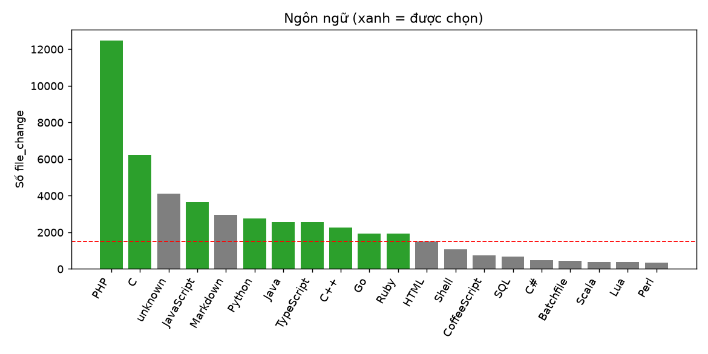
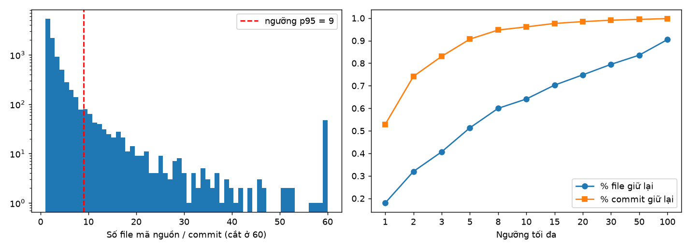

# EDA – Giai đoạn A (cấp file)

## A1. Chọn ngôn ngữ
Quy tắc: Ngôn ngữ LẬP TRÌNH, có grammar tree-sitter, ≥ 1 500 file_change trong CVEfixes.

| lang | files | commits | programming | tree_sitter | selected |
|---|---|---|---|---|---|
| PHP | 12,464 | 2,468 | 1 | 1 | 1 |
| C | 6,220 | 3,418 | 1 | 1 | 1 |
| unknown | 4,126 | 183 | 0 | 0 | 0 |
| JavaScript | 3,656 | 1,302 | 1 | 1 | 1 |
| Markdown | 2,942 | 1,489 | 0 | 0 | 0 |
| Python | 2,753 | 1,059 | 1 | 1 | 1 |
| Java | 2,571 | 583 | 1 | 1 | 1 |
| TypeScript | 2,563 | 767 | 1 | 1 | 1 |
| C++ | 2,252 | 1,094 | 1 | 1 | 1 |
| Go | 1,919 | 499 | 1 | 1 | 1 |
| Ruby | 1,917 | 713 | 1 | 1 | 1 |
| HTML | 1,499 | 523 | 0 | 0 | 0 |
| Shell | 1,081 | 659 | 1 | 1 | 0 |
| CoffeeScript | 735 | 328 | 1 | 0 | 0 |
| SQL | 685 | 311 | 0 | 0 | 0 |
| C# | 484 | 107 | 1 | 1 | 0 |
| Batchfile | 457 | 247 | 0 | 0 | 0 |
| Scala | 395 | 177 | 1 | 1 | 0 |
| Lua | 393 | 269 | 1 | 1 | 0 |
| Perl | 341 | 208 | 1 | 1 | 0 |

**Chọn:** PHP, C, JavaScript, Python, Java, TypeScript, C++, Go, Ruby

## A2. Ngưỡng tangled commit
Quy tắc: Ngưỡng = phân vị 95 của số file MÃ NGUỒN mỗi commit (loại 5% commit lớn nhất).

Phân vị số file mã nguồn/commit: {'p50': 1.0, 'p75': 3.0, 'p90': 5.0, 'p95': 9.0, 'p99': 29.0}

| max_code_files | files_kept | pct_files_kept | pct_commits_kept |
|---|---|---|---|
| 1 | 5,398 | 0.180 | 0.529 |
| 2 | 9,591 | 0.320 | 0.742 |
| 3 | 12,207 | 0.407 | 0.831 |
| 5 | 15,404 | 0.513 | 0.907 |
| 8 | 17,993 | 0.600 | 0.947 |
| 10 | 19,243 | 0.641 | 0.961 |
| 15 | 21,087 | 0.703 | 0.977 |
| 20 | 22,457 | 0.748 | 0.985 |
| 30 | 23,853 | 0.795 | 0.991 |
| 50 | 25,081 | 0.836 | 0.995 |
| 100 | 27,156 | 0.905 | 0.998 |
| ∞ | 30,005 | 1.000 | 1.000 |

**Chọn ngưỡng = 9 file mã nguồn.** Quy tắc cũ (>10 file bất kỳ) loại 11,817 / 30,005 file ứng viên; quy tắc mới loại 11,360.

## A3. Dữ liệu cá nhân trong metadata

- Commit có tên tác giả: 12,104/12,107; có tên committer: 12,104
- Commit message chứa email: 2,525
- **Quyết định:** dữ liệu dẫn xuất KHÔNG chứa cột author/committer/msg; email trong mã nguồn được thay bằng `<EMAIL>`.

