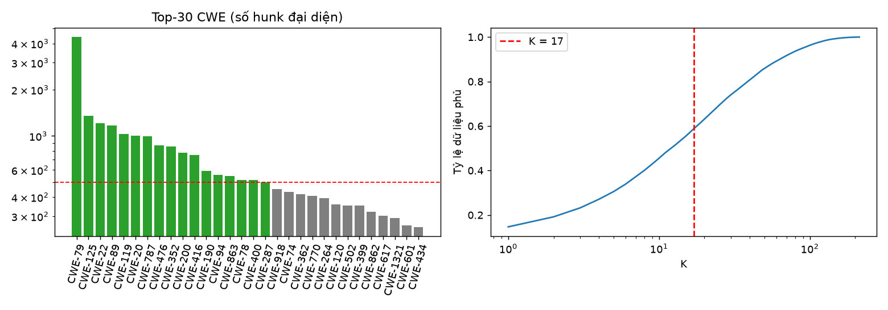
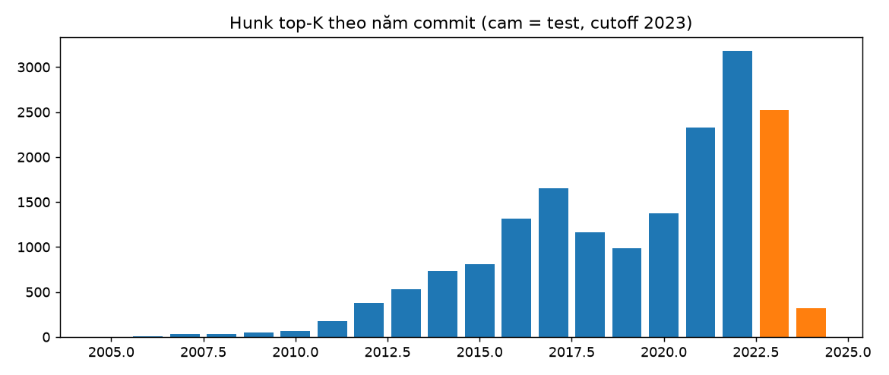
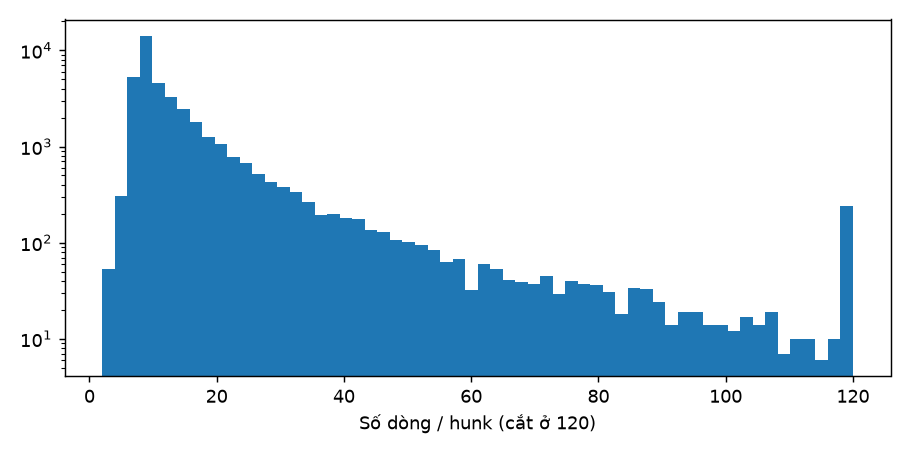
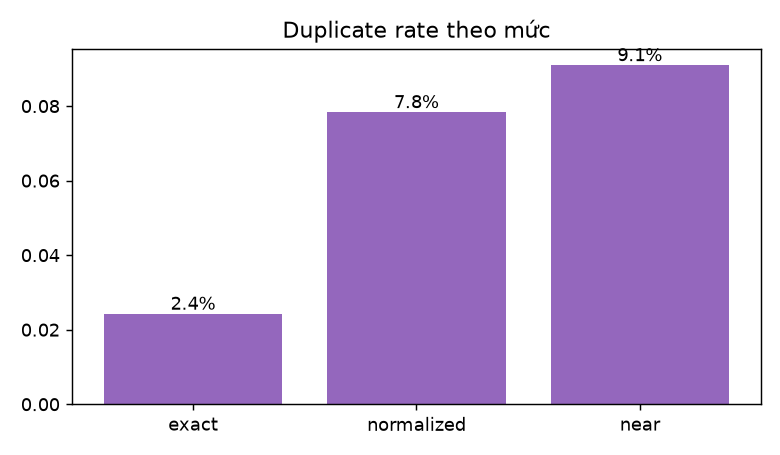

# EDA – Giai đoạn B (cấp hunk)

## B1. Top-K CWE & mất cân bằng lớp
Quy tắc: Giữ CWE có ≥ 500 hunk đại diện (≈ ≥ 100 mẫu/lớp trong test 20%).

- Hunk đại diện có nhãn cụ thể: 30,021; số CWE: 213
- Top-10 phủ 45.5%, top-20 phủ 63.1%
- **Chọn K = 17**, phủ 58.8% dữ liệu có nhãn; lớp còn lại bị loại (không gộp 'Other' vì không đồng nhất)
- Mất cân bằng trong top-K: max/min = 8.81, entropy chuẩn hóa = 0.9188, lớp lớn nhất chiếm 25.0%
- **Biện pháp:** class_weight='balanced'; metric chính Macro-F1; báo cáo per-class P/R; không oversampling.

| CWE | hunks |
|---|---|
| CWE-79 | 4,404 |
| CWE-125 | 1,353 |
| CWE-22 | 1,211 |
| CWE-89 | 1,169 |
| CWE-119 | 1,030 |
| CWE-20 | 1,002 |
| CWE-787 | 992 |
| CWE-476 | 868 |
| CWE-352 | 853 |
| CWE-200 | 778 |
| CWE-416 | 749 |
| CWE-190 | 594 |
| CWE-94 | 558 |
| CWE-863 | 547 |
| CWE-78 | 517 |
| CWE-400 | 517 |
| CWE-287 | 500 |

## B2. Mốc time split
Quy tắc: Năm nhỏ nhất sao cho phần hunk có nhãn từ năm đó trở đi ≤ 25% và gần 20% nhất.

**Chọn cutoff = 2023** → test chiếm 16.1% hunk top-K.

## B3. Kích thước hunk

- Phân vị số dòng: {'p50': 10.0, 'p90': 27.0, 'p99': 93.0}
- Chỉ thêm dòng: 13,359 · chỉ xóa: 1,991 · cả hai: 24,904

## B4. Trùng lặp & chất lượng nhãn

| mức | n_clusters | duplicate_rate | max_cluster_size | rows_in_dup_clusters | label_conflict_clusters | label_conflict_rows |
|---|---|---|---|---|---|---|
| exact | 39,280 | 0.024 | 16 | 1,670 | 5 | 10 |
| normalized | 37,103 | 0.078 | 98 | 4,746 | 141 | 752 |
| near | 36,595 | 0.091 | 140 | 5,397 | 168 | 1,037 |

- Nhãn: {'single': 33054, 'nonspecific': 5209, 'multi': 1991}

## B5. Rò rỉ train–test theo chiến lược chia

| split | n_train | n_test | shared_repo | shared_cve | shared_dup_exact | shared_dup_normalized | shared_dup_near | shared_leak_group |
|---|---|---|---|---|---|---|---|---|
| split_random | 21,014 | 6,005 | 1,456 | 2,876 | 0 | 0 | 0 | 1,438 |
| split_project | 20,687 | 6,406 | 0 | 0 | 0 | 0 | 0 | 0 |

## B6. Privacy trong hunk

- {'hunks_with_masked_email': 400, 'emails_masked': 1858}

